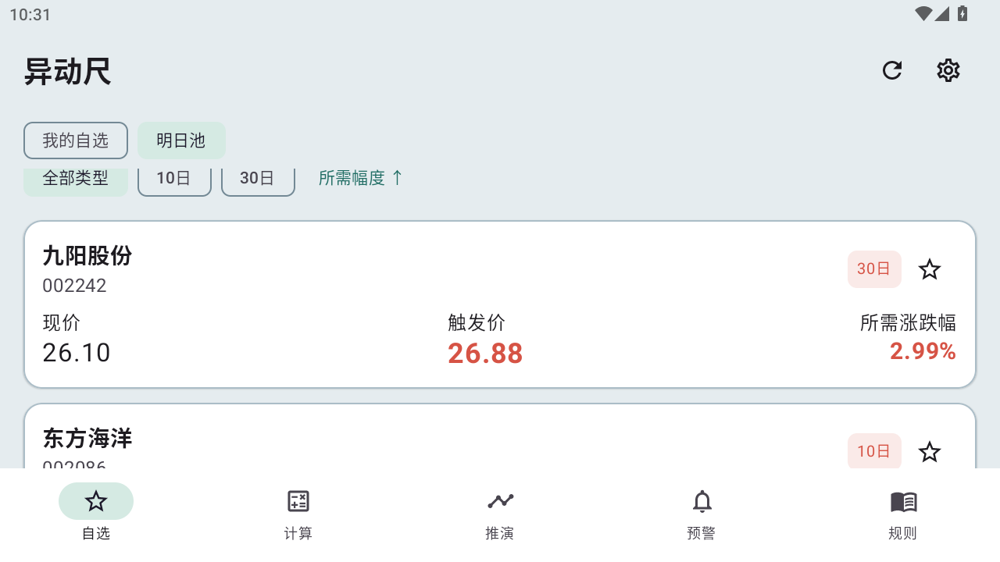

# 异动尺

输入股票代码，查看今天和下一交易日的异动临界价；扫描沪深股票，找到明日可能达到严重异动价格条件的候选。

原生 Android · Kotlin / Jetpack Compose · Android 8.0 及以上 · 无需注册

**当前版本：0.3.2 测试版。** 盘中从今日池刷新上一交易日筛出的候选。明日池在收盘后增量更新全市场，自动导入已有缓存。

[下载安装包](https://github.com/leekooyo/YidongChi/releases/download/v0.3.2/YidongChi-0.3.2-debug.apk) · [发布说明与源码](https://github.com/leekooyo/YidongChi/releases/tag/v0.3.2) · [规则依据](docs/规则覆盖与依据.md) · [收盘更新验收](docs/收盘后增量更新验收.md)

## 可以做什么

| 功能 | 用途 |
|---|---|
| 异动计算 | 自动读取个股及对应指数行情，计算3/10/30日上下行临界价，查看窗口、公式和报价取整 |
| 今日池 | 盘中批量刷新上一收盘批次为当天筛出的候选，使用盘中指数计算当日临界价 |
| 明日池 | 收盘后批量同步全部沪深A股，在本地重算次日10日/30日候选；正常连续交易日仅追加新日线 |
| 自选管理 | 搜索、批量添加、分组、置顶、排序、静音；从明日池一键关注 |
| 十日推演 | 独立选股；固定涨跌、连续涨停、连续跌停、逐日路径，换页后保留输入 |
| 近期记录与提醒 | 独立选股，支持当前股/全部自选；最近十个交易日事件与前台条件提醒 |
| 规则查询 | 搜索54条规则和来源索引，查看条款、生效时间、核验状态和原文；保留31份原文归档 |
| 日常使用 | 深浅主题、大数字、本地快照回放、摘要复制、自选备份与恢复 |

## 安装与开始使用

1. 在 [v0.3.2 Release](https://github.com/leekooyo/YidongChi/releases/tag/v0.3.2) 下载 `YidongChi-0.3.2-debug.apk` 并安装。
2. 搜索股票代码或名称，点击星号加入自选。
3. 在“计算”页选股并切换当日或次日，选择“指数不变”或调整假设。点击临界价查看依据。
4. “推演”和“预警”各自搜索选股，不跟随计算页；推演保留自己的模式、路径及指数输入，预警可切换“全部自选”。
5. 在自选页上方进入“明日池”，收盘后点击“更新收盘数据”。

本版使用个人测试签名，包名 `cn.yidongchi.app`，版本 `0.3.2` / `versionCode 7`。可覆盖本项目此前同签名的测试版；不同签名构建无法直接覆盖。Release 同时提供源码包和 SHA-256 校验文件。

## 今日池怎么用

上一交易日收盘后先更新「明日池」。盘中进入「自选 → 今日池 → 更新盘中数据」，只请求候选股的报价和计算所需的指数。每次都从上一收盘批次取候选，即使某只股票暂时跌出结果，下次仍会刷新。池外股票在盘中扫描范围之外。

## 明日池怎么用

扫描沪深主板、创业板、科创板股票及相应清单内存托凭证，**不包含北交所、B股、基金和债券**。原有单股计算仍保留B股映射。

- 默认指数不变，按所需涨跌幅由近到远排列。
- 支持上行/下行、10日/30日、只看自选、升降序。
- 每只股票显示现价、触发价、所需涨跌幅和对应条件；已满足的显示“零涨跌已达”。
- 点击股票进入“次日、指数不变”的计算页；点击星号加入自选。
- 升级自动导入此前扫描缓存；首次没有缓存时仍需建立历史库。保持应用在前台，可暂停后继续；已保存的报价批次不重复下载。
- 每个收盘日更新一次。同日再次点击只探测指数数据日期，已有完整结果便直接复用。
- 连续正常交易日按100只批量报价追加日线；缺口、新股或前收价不衔接时才定向回补历史。停牌不补造交易日。
- 更新中或失败时保留上次完整候选；没有旧完整结果时显示已处理部分，并标记未完成。
- “更多”提供强制同步本日和重建历史库；重建会重新下载历史，平日无需使用。
- 基准时间、已处理数量和排除原因可查看。未完成批次和失败项不会冒充完整结果。

个股与指数日线成组使用腾讯或东方财富来源，保存到本地SQLite库。股票保留最近120条、指数保留最多320条；每日更新证券清单，全部股票本地重算。按5,563条清单估算，正常日约56次清单分页＋56次批量报价＋1次指数探测，另加必要的历史修复请求。实际请求和耗时受行情源、缺口及新股数量影响。

只在前台手动更新，没有服务器或后台定时任务。行情源未提供新的收盘日时会保留其实际日期；本工具不能保证自动发现所有历史复权修订，可按需要强制同步或重建。



[扫描概况](docs/screenshots-v020/pool-up.png) · [下行条件示例](docs/screenshots-v020/pool-down.png)

## 本版验证

| 验证项 | 结果 |
|---|---|
| 常规JVM测试 | 74项通过，2项需显式开启的全市场测试默认跳过 |
| 0.3.0 增量缓存审计 | 额外开启本地缓存审计：5,563条全部处理，导入5,226份来源序列；模拟次日56次批量报价、8只定向修复，同日重复仅1次探测，无网络扫描 |
| 安卓测试 | Android 12 / API 32 模拟器，4 项股票池测试通过，含盘中仅刷新 1 只候选及收盘暂停续传 |
| 沿用0.2.0历史扫描证据 | 2026-11-09清单5,563条全部处理：5,216只完成计算、347条排除、0条读取失败 |
| 同次快照候选 | 6只：上行5、下行1；这是该次快照结果，不是实时数量 |
| 截图价格对照 | 九阳26.88、东方海洋4.64、奥雅64.76、贝特利41.34，与次日、指数不变计算一致 |

0.3.0 收盘更新过程与日志见[收盘后增量更新验收](docs/收盘后增量更新验收.md)，历史全市场证据见[明日池验收](docs/明日异动池验收.md)。历史扫描包含缓存复用和数据源切换，不能据此承诺首次安装的扫描耗时。其他安卓版本和实体机体验尚未逐一验证。

## 计算口径与已知限制

本工具给出的是**价格条件估算**。触及价格条件不等于交易所已经认定异动，也不代表一定停牌。

- 保留精确分数至最终报价取整：上行向上、下行向下取到最小报价单位，并枚举合法起点。
- 历史收益依赖行情源前复权序列；除权参考价、特殊状态和公告重置尚未全面独立核实。可按原公告校准重置起算日。
- 行情源候选记录与已确认公告分开显示；未读到记录不等于没有异动。
- 科创板累计公式仍存在体系解释与完整官方数值案例验证缺口，详见[规则覆盖与依据](docs/规则覆盖与依据.md)。
- 官方交易日历目前收录2026年，跨年目标需先更新日历。
- 提醒只在应用前台运行，不提供锁屏或后台持续到价推送。免费行情接口的可用性和覆盖可能变化。

## 从源码构建

| 项目 | 版本 |
|---|---|
| JDK | 17 |
| Gradle / Android Gradle Plugin | 8.11.1 / 8.9.2 |
| Kotlin | 2.1.20 |
| Android SDK | compile / target 35，min 26 |

安装 SDK 的 `platforms;android-35`、`build-tools;35.0.0`、`platform-tools`。设置 `ANDROID_HOME`，或在项目根目录 `local.properties` 配置 `sdk.dir=你的SDK路径`。

```powershell
git clone https://github.com/leekooyo/YidongChi.git
cd YidongChi
.\gradlew.bat :core:test :app:testDebugUnitTest :app:assembleDebug
```

APK 位于 `app/build/outputs/apk/debug/app-debug.apk`。Android Studio 可直接打开项目根目录。依赖仓库配置了国内镜像，并保留官方仓库。

运行安卓测试（需连接设备或模拟器）：

```powershell
.\gradlew.bat :app:assembleDebugAndroidTest
adb install -r app/build/outputs/apk/debug/app-debug.apk
adb install -r app/build/outputs/apk/androidTest/debug/app-debug-androidTest.apk
adb shell am instrument -w cn.yidongchi.app.test/androidx.test.runner.AndroidJUnitRunner
```

## 工程与文档

```text
core/                       精确计算、窗口、交易日历和情景推演
app/                        行情、扫描、缓存、存储和安卓界面
app/src/main/assets/        规则查询目录
docs/rule-sources/          官方原文归档
docs/validation-v030/       本版增量更新测试证据
docs/validation-v021/       历史页面独立性测试证据
docs/validation-v020/       历史全市场扫描证据
docs/superpowers/           设计与实现计划
```

- [0.3.2发布说明](docs/releases/v0.3.2.md)
- [0.3.0发布说明](docs/releases/v0.3.0.md)
- [收盘后增量更新验收](docs/收盘后增量更新验收.md)
- [0.2.1发布说明](docs/releases/v0.2.1.md)
- [页面解耦验收](docs/页面解耦验收.md)
- [0.2.0发布说明](docs/releases/v0.2.0.md)
- [明日异动池验收](docs/明日异动池验收.md)
- [规则覆盖与依据](docs/规则覆盖与依据.md)
- [0.1.1价格对照与修复](docs/2026-11-09-v011-修复与价格对照.md)
- [开发目录迁移](docs/开发目录迁移.md)：本机主开发目录 `D:\Projects\YidongChi`，SDK与Gradle位于 `D:\AndroidDev`；冗余产物已移出工作目录并暂存待清理，版本回退使用Git历史与Release。
